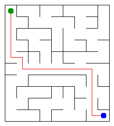

# Assignment 3. Maze Escape

Student ID: 253741  
Name: Temirlan Mukhametov  
Group: SE-2532  
Maze size (rows x columns): 10 x 9

This project uses Java 17 or newer. The personal files were generated with `java tools/MakeVariant.java 253741 data`.

## Program output

From `java -cp out Main` on my data:

```text
Broken: 89
Kept: 72
Last broken wall: 142
MST cost: 26965
Heaviest broken wall: 781
Path length: 17
DFS visited: 61
Dead ends: 28
Zones: 90
Largest zone: 1
Is DAG: 1
Flow stages: 16
Fastest route cost: 23
```

My maze:



## Questions

**Mission 0.** `find` returns the representative (root) of a cell's set, and `union` joins two different sets. Union by size keeps trees shallow; path compression makes future finds faster by pointing visited nodes directly to the root.

**Mission 1.** The full grid is connected, and accepting a wall only when it joins different components creates a spanning tree. A spanning tree of `R*C` cells has exactly `R*C - 1` broken walls. The grid starts with `R(C-1) + C(R-1)` internal walls, so the number kept is `(R-1)(C-1)`.

**Mission 2.** Kruskal and Prim both give MST cost **26965** for my maze. They use different edge selection rules, but each produces a minimum spanning tree of the same weighted graph; the minimum total cost is therefore equal.

**Mission 3.** Mission 1 creates a connected graph without cycles, so it is a tree and has exactly one simple path between any two cells. I used an explicit array stack for DFS instead of recursive calls, so the call stack cannot overflow on a 1000 x 1000 maze.

**Mission 4.** The first pass records vertices by finishing time. The second pass follows reversed slides in decreasing finishing-time order so it collects one complete strongly connected component without spreading into later components. There are no self-slides, so every directed cycle contains at least two cells in one zone; the graph is a DAG exactly when the number of zones equals the number of cells.

**Mission 5.** Kosaraju numbers zones in topological order: every slide between zones goes from a smaller number to a larger one. Therefore, when processing a zone, all possible predecessors have already been processed. The pass over the zone graph takes `O(z + s)` time, where `z` is the number of zones and `s` the number of slides; it computes both the longest chain and the cheapest route.

## Timing (Mission 7)

Milliseconds, five runs each, from `java -Xmx2g -cp out Bench` on this machine. Values are rounded to whole milliseconds.

| maze | Kruskal runs (avg) | Prim runs (avg) |
|---|---:|---:|
| 100 x 100 | 15, 5, 3, 3, 3 (6) | 17, 7, 6, 5, 5 (8) |
| 300 x 300 | 32, 19, 19, 19, 18 (21) | 97, 90, 87, 90, 87 (90) |
| 1000 x 1000 | 420, 335, 372, 325, 358 (362) | 1940, 1839, 1844, 1860, 1861 (1869) |

Both algorithms take longer as the number of cells and walls grows. In these measurements Prim is slower than Kruskal, especially on the largest maze; these are machine-specific timings, and the first run also includes warm-up effects.

## Complexity

`n` is the number of cells, `m` the number of walls (or slides), `z` the number of zones, and `alpha` the inverse Ackermann function.

| algorithm | time | extra space | assumptions |
|---|---|---|---|
| DSU find and union | amortized `O(alpha(n))` | `O(n)` for the DSU | union by size and path compression |
| Kruskal | `O(m log m)` | `O(n + m)` | connected undirected wall graph |
| Prim | `O(m log m)` | `O(n + m)` | connected undirected wall graph; priority queue |
| DFS | `O(n + m)` | `O(n + m)` | graph of broken walls; iterative stack |
| Kosaraju | `O(n + m)` | `O(n + m)` | directed slide graph; two iterative passes |
| Route in the zone graph | `O(z + m)` | `O(z + m)` | zone numbers are in topological order |

## Verification

`java tools/Check.java` passes its DSU checks and all 13 output lines for each of `tiny`, `small`, and `dag`. The program also ran on the personal data above and generated `output/maze.png` and `output/maze.html`.
